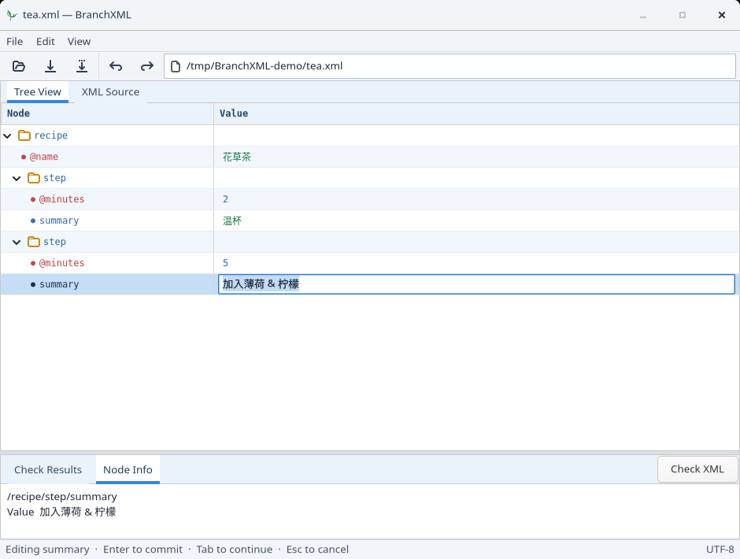

# BranchXML

**English** · [简体中文](README.zh-CN.md)

BranchXML is a desktop XML reader and editor for Ubuntu, built with Python and GTK 4. Browse the tree on the left and edit attribute values or text on the right. Saving a change preserves the original formatting everywhere else in the file.



## Install and open a file

Prebuilt packages and source archives for published versions are listed on [GitHub Releases](https://github.com/hqy2435662352/branchxml/releases).

On Ubuntu 24.04 LTS and 26.04 LTS, the Debian package installs BranchXML and its runtime dependencies. From the directory containing the downloaded package, run `sudo apt install ./branchxml_0.1.0_all.deb`. Choose **Open With → BranchXML** on a local XML file, drop a file onto the window, or run `branchxml "my recipe.xml"`. Launching the app without a file opens an untitled document. **Ctrl+N** starts another document and the first save opens the file chooser.

For a user-only installation from the source archive or checkout, run `./install.py`. The default prefix is `~/.local`; `./install.py --uninstall` removes it. The interpreter needs GTK 4.12 or later, PyGObject, Pygments and lxml. Ubuntu provides these through `gir1.2-gtk-4.0`, `python3-gi`, `python3-pygments` and `python3-lxml`. Use `--python /path/to/venv/bin/python` to select another interpreter with the same dependencies.

To try the included herbal tea recipe directly from the checkout or source archive, run

```sh
/usr/bin/python3 prototypes/gtk/branchxml.py examples/demo.xml
```

BranchXML follows your desktop language preferences and falls back to English. Choose **View → Language** (**视图 → 语言**) to switch between **System Default**, **English** and **简体中文**. The interface updates immediately and remembers your choice. The system file chooser follows your desktop’s language settings.

In the second `step`, click the `5` next to `@minutes` and type a new steeping time. Press **Tab** to commit it and start editing the next value, the `summary` that reads “加入薄荷 & 柠檬” (add mint and lemon). Press **Esc** to discard edits to the summary and keep the new time.

To open your own XML file, pass its path on the command line or press **Ctrl+O** in the editor. **Ctrl+L** focuses the address bar. Relative paths resolve from the current document’s directory.

## Working in the tree

Icons and colors distinguish node types. A row stays under the pointer when you collapse or expand it, even at the end of a document. Reopening a parent restores each descendant’s previous expansion state.

| Action | How to use it |
| --- | --- |
| Edit a single-line value | Click the value or select its row and press **F2**. **Enter** commits the edit and **Esc** cancels it. |
| Edit consecutive values | **Tab** commits and advances to the next visible editable value. **Shift+Tab** moves back. A Chinese input method handles candidate selection first. |
| Open the node menu | Right-click either column on the target row, or select the row and press **Shift+F10** or the **Menu** key. |
| Add a node | **Insert** adds a sibling element or attribute. **Ctrl+Insert** adds a child element and **Alt+Insert** adds an attribute. Type the name and press **Enter**. |
| Duplicate or delete | **Ctrl+D** copies the selected node and its descendants immediately after the original. **Delete** removes the selected subtree. |
| Move a subtree | **Alt+↑** or **Alt+↓** swaps siblings. Drag an element name onto the middle of another element to make it a child. Drop at the top or bottom edge to insert before or after it. The entire move is one undo step. |
| Navigate the tree | **→** expands a branch or selects its first child. **←** collapses a branch or selects its parent. **Ctrl+J** locates the selected row in the XML source, or the source cursor in the tree. |
| Rename or edit multiple lines | **Shift+F2** renames an element or attribute. **Shift+Enter** opens the multiline editor. **Ctrl+Enter** applies the value. |
| Cut, copy and paste nodes | **Ctrl+X**, **Ctrl+C** and **Ctrl+V** operate on the tree selection. Paste adds content to an element. **Ctrl+Shift+V** inserts after the selection. The inline text editor uses the usual text clipboard. |
| Insert mixed content | Right-click an element and choose **Add Text, Comment or Instruction…** to append text, CDATA, a comment or a processing instruction. |

Copying or moving an element preserves all its attribute values, including any sequence numbers in a recipe. Duplicating a single attribute gives the copy an available name. XML treats adjacent text nodes as one text node.

## Finding and validating XML

In the tree, **Ctrl+F** or **Ctrl+I** searches names and values, including collapsed descendants. **F3** and **Shift+F3** step through matching rows. **Esc** returns to the selected row, ready for **F2**. **Ctrl+H** replaces text inside the current value or across matching values in one undo step. Enable **Match case** or **Regex** as needed. Regex replacements accept capture groups such as `\1`.

Choose **Edit → Find by XPath…**, enter an XPath 1.0 expression such as `//step[@minutes='5']/@minutes` and press **Enter**. Node results select tree rows and scalar queries such as `count(//step)` show their value. Prefixes declared in the XML are available. Use `default` for a default namespace, or enter an explicit binding such as `r=urn:recipes`.

The **XML Source** tab shows a read-only view of the document, including committed edits you have yet to save. Element names, attribute names, strings, numbers and booleans have distinct colors.

On the source tab, **Ctrl+F** searches the displayed XML literally, ignoring case. Every match is highlighted. **Enter** or **F3** moves forward and **Shift+F3** moves back. Both directions wrap around. In the search field, **Esc** clears the query and returns focus to the source.


In the lower pane, **Check XML** checks document syntax and namespaces. Errors include the line and column when the parser supplies them. **Node Info** shows the selected node’s path and its value or child count. Drag the dividers to adjust the width of the node column or the height of the lower pane.

Use **View → Validate with XML Schema…** to attach a local XSD 1.0 file. Committing edits updates the diagnostics. Click a line number to jump to the source. Schema includes and imports can use files within the selected schema’s folder and its subdirectories. Opening another document clears the schema. Schema errors are advisory; saving requires well-formed XML.

## Saving and undoing changes

**Ctrl+S** saves the file. **Ctrl+Shift+S** saves a copy and continues editing that file. Both actions commit the active field and check the XML before writing. If another program has changed the original on disk, BranchXML prompts you to save a separate copy. Opening another file or closing the window with unsaved edits gives you the choice to save, discard or cancel.

Changing one value preserves the indentation, attribute quotes, entity spellings, CDATA, byte order mark and line endings outside that edit. Structural edits also affect only the relevant XML fragments. Adding text to a self-closing element produces a matching pair of tags. Reading and saving have been tested with UTF-8 and UTF-16 files. Opening a document with a DTD reports an error.

**View → Changes Since Save** shows the lines that would change on disk. **Compare with XML File…** compares the current document with another local XML file. The comparison distinguishes exact byte equality, encodings and line endings.

**Ctrl+Z** undoes a change. **Ctrl+Shift+Z** or **Ctrl+Y** redoes it. Each value changed with Tab and each node operation is a separate undo step. While typing, undo acts on the active field first. Saving keeps the undo history, and opening another file starts a new history.

## Running the tests

From the repository root in an Ubuntu graphical session, run the full suite for keyboard editing, tree folding, source search and byte-for-byte save behavior.

```sh
/usr/bin/python3 -m unittest discover -s prototypes/gtk
```

For document I/O and undo tests alone, run `/usr/bin/python3 prototypes/gtk/test_document.py`. Chinese candidate selection, Tab navigation and Esc cancellation have also been checked on Wayland with Fcitx 4 and Sogou Pinyin.

For an isolated graphical test session, run `packaging/test-wayland.sh` with Sway and D-Bus installed. Build the Debian package, user-installable source archive and SHA-256 checksums with `/usr/bin/python3 packaging/build_release.py`. Outputs go to `dist/`.

BranchXML is distributed under the [MIT License](LICENSE). Changes for each version are listed in the [release notes](CHANGELOG.md).
