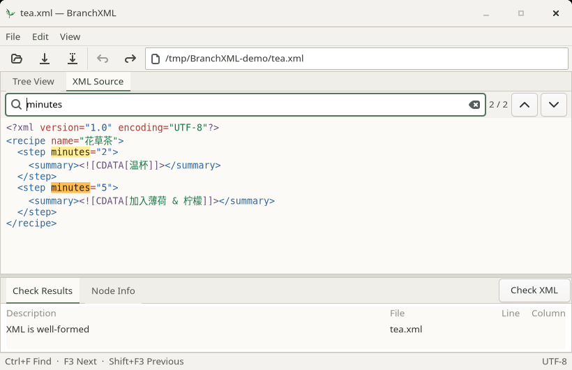

# BranchXML — a visual XML editor for Linux

[Download for Ubuntu (.deb, v0.1.0)](https://github.com/hqy2435662352/branchxml/releases/download/v0.1.0/branchxml_0.1.0_all.deb) · [Latest release and checksums](https://github.com/hqy2435662352/branchxml/releases/latest) · [简体中文](README.zh-CN.md)

Browse a local configuration file or recipe in a two-column XML viewer. The left column shows the node tree. Click a value on the right to edit it, then press **Tab** to move to the next field. Changing one value preserves the surrounding XML byte for byte, including indentation, attribute quotes and line endings.

If you use Microsoft XML Notepad on Windows, the two-column layout will look familiar. On Ubuntu you can also search collapsed branches, locate an attribute with XPath, or validate a file against a local XML Schema (XSD).


## Install on Ubuntu

BranchXML has been tested on **Ubuntu 24.04 LTS and 26.04 LTS**. From the directory containing the downloaded `.deb`, run

```sh
sudo apt install ./branchxml_0.1.0_all.deb
```

Launch **BranchXML** from the applications menu, choose **Open With → BranchXML** on an XML file, or run `branchxml "my recipe.xml"`. You can also drop a local file onto the window.

The interface follows your desktop language and falls back to English. Under **View → Language**, choose **System Default**, **English** or **简体中文**. The change takes effect immediately and is remembered next time. The system file chooser follows the desktop language.

<details>
<summary>Install for your user account or run from source</summary>

From the extracted source archive or a checkout, run `./install.py` to install under `~/.local`. To uninstall, run `./install.py --uninstall`. BranchXML uses Python, GTK 4.12 or later, PyGObject, Pygments and lxml. Ubuntu provides these through `gir1.2-gtk-4.0`, `python3-gi`, `python3-pygments` and `python3-lxml`. Use `--python /path/to/venv/bin/python` to select an interpreter with those dependencies.

To try the editor directly from the source directory, run

```sh
/usr/bin/python3 prototypes/gtk/branchxml.py examples/demo.xml
```

</details>

## Try a one-value edit

The bundled tea recipe has two steps. After installing the `.deb`, open it with `branchxml /usr/share/branchxml/examples/demo.xml`. Press **Ctrl+Shift+S** to save a working copy in your home folder. [View the sample XML](examples/demo.xml)

1. In the second `step`, click the `5` beside `@minutes` and type `8`.
2. Press **Tab**. The time is committed and the next field, `summary`, opens for editing. Type a few letters and press **Esc** to restore the original instructions.
3. Open **View → Changes Since Save**. Only the steeping time has changed.

```diff
-  <step minutes="5">
+  <step minutes="8">
```

Close the comparison and press **Ctrl+Z**. Saving now restores the working copy to the original bytes.

## Working in the tree

Right-click a node to duplicate, move or delete it with its children, or drag an element to another parent. Icons and colors distinguish node types. A row stays under the pointer when you collapse it, even at the end of a document. Reopening a parent restores each descendant’s previous expansion state.

<details>
<summary>Keyboard shortcuts and node commands</summary>

| Action | How to use it |
| --- | --- |
| Edit a single-line value | Click the value or select its row and press **F2**. **Enter** commits the edit and **Esc** cancels it. |
| Edit consecutive values | **Tab** commits and advances to the next visible editable value. **Shift+Tab** moves back. A Chinese input method handles candidate selection first. |
| Open the node menu | Right-click either column on the target row, or select the row and press **Shift+F10** or the **Menu** key. |
| Add a node | **Insert** adds a sibling element or attribute. **Ctrl+Insert** adds a child element and **Alt+Insert** adds an attribute. Type the name and press **Enter**. |
| Duplicate or delete | **Ctrl+D** copies the selected node and its descendants immediately after the original. **Delete** removes the selected subtree. |
| Move a subtree | **Alt+↑** or **Alt+↓** swaps siblings. Drag an element name onto the middle of another element to make it a child. Drop at the top or bottom edge to insert before or after it. The entire move is one undo step. |
| Navigate the tree | **→** expands a branch or selects its first child. **←** collapses a branch or selects its parent. **Ctrl+J** locates the selected row in the XML source, or the source cursor in the tree. |
| Rename or edit multiple lines | **Shift+F2** renames an element or attribute. **Shift+Enter** opens the multiline editor. **Ctrl+Enter** applies the value. |
| Cut, copy and paste nodes | **Ctrl+X**, **Ctrl+C** and **Ctrl+V** operate on the tree selection. Paste adds content to an element. **Ctrl+Shift+V** inserts after the selection. The inline text editor uses the usual text clipboard. |
| Insert mixed content | Right-click an element and choose **Add Text, Comment or Instruction…** to append text, CDATA, a comment or a processing instruction. |

Copying or moving an element preserves all its attribute values, including any sequence numbers in a recipe. Duplicating a single attribute gives the copy an available name. XML treats adjacent text nodes as one text node.

</details>

## Finding and validating XML

In the tree, **Ctrl+F** or **Ctrl+I** searches names and values, including collapsed descendants. **F3** and **Shift+F3** step through matching rows. **Esc** returns to the selected row, ready for **F2**. **Ctrl+H** replaces text inside the current value or across matching values in one undo step. Enable **Match case** or **Regex** as needed. Regex replacements accept capture groups such as `\1`.

Choose **Edit → Find by XPath…**, enter an XPath 1.0 expression such as `//step[@minutes='5']/@minutes` and press **Enter**. Node results select tree rows and scalar queries such as `count(//step)` show their value. Prefixes declared in the XML are available. Use `default` for a default namespace, or enter an explicit binding such as `r=urn:recipes`.

The **XML Source** tab shows a read-only view of the document, including committed edits you have yet to save. Element names, attribute names, strings, numbers and booleans have distinct colors.

On the source tab, **Ctrl+F** searches the displayed XML literally, ignoring case. Every match is highlighted. **Enter** or **F3** moves forward and **Shift+F3** moves back. Both directions wrap around. In the search field, **Esc** clears the query and returns focus to the source.



In the lower pane, **Check XML** checks document syntax and namespaces. Errors include the line and column when the parser supplies them. **Node Info** shows the selected node’s path and its value or child count. Drag the dividers to adjust the width of the node column or the height of the lower pane.

Use **View → Validate with XML Schema…** to attach a local XSD 1.0 file. Committing edits updates the diagnostics. Click a line number to jump to the source. Schema includes and imports can use files within the selected schema’s folder and its subdirectories. Opening another document clears the schema. Schema errors are advisory. Saving requires well-formed XML.

## Saving and undoing changes

Launch without a file or press **Ctrl+N** to start an untitled document. The first save opens the file chooser. **Ctrl+O** opens an existing XML file and **Ctrl+L** focuses the address bar. Relative paths resolve from the current document’s directory.

**Ctrl+S** saves the file. **Ctrl+Shift+S** saves a copy and continues editing that file. Both actions commit the active field and check the XML before writing. If another program has changed the original on disk, BranchXML prompts you to save a separate copy. Opening another file or closing the window with unsaved edits gives you the choice to save, discard or cancel.

Changing one value preserves the indentation, attribute quotes, entity spellings, CDATA, byte order mark and line endings outside that edit. Structural edits also affect only the relevant XML fragments. Adding text to a self-closing element produces a matching pair of tags. Reading and saving have been tested with UTF-8 and UTF-16 files. Opening a document with a DTD reports an error.

**View → Changes Since Save** shows the lines that would change on disk. **Compare with XML File…** compares the current document with another local XML file. The comparison distinguishes exact byte equality, encodings and line endings.

**Ctrl+Z** undoes a change. **Ctrl+Shift+Z** or **Ctrl+Y** redoes it. Each value changed with Tab and each node operation is a separate undo step. While typing, undo acts on the active field first. Saving keeps the undo history, and opening another file starts a new history.

## Running the tests

From the repository root in an Ubuntu graphical session, run the full suite for keyboard editing, tree folding, source search and byte-for-byte save behavior.

```sh
/usr/bin/python3 -m unittest discover -s prototypes/gtk
```

For document I/O and undo tests alone, run `/usr/bin/python3 prototypes/gtk/test_document.py`. Chinese candidate selection, Tab navigation and Esc cancellation have also been checked on Wayland with Fcitx 4 and Sogou Pinyin.

For an isolated graphical test session, run `packaging/test-wayland.sh` with Sway and D-Bus installed. Build the Debian package, user-installable source archive and SHA-256 checksums with `/usr/bin/python3 packaging/build_release.py`. Outputs go to `dist/`.

BranchXML is distributed under the [MIT License](LICENSE). Changes for each version are listed in the [release notes](CHANGELOG.md).
