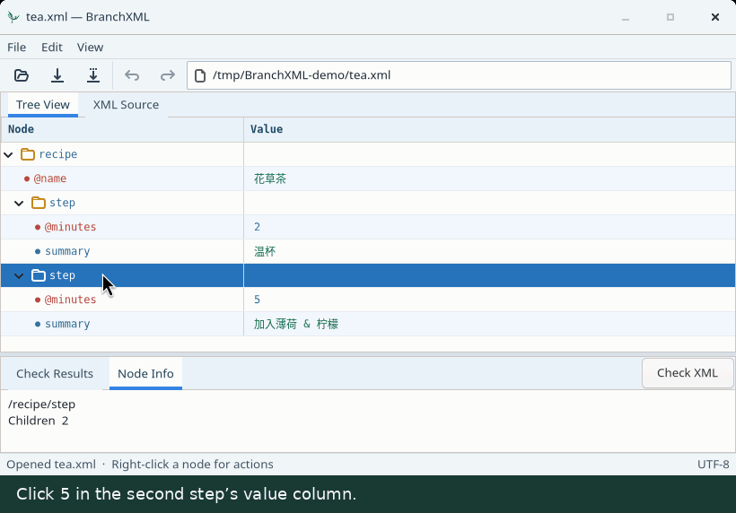

#  BranchXML

BranchXML is a tree-based XML editor for Linux. Expand a node on the left and edit its values on the right. Change one attribute value and the rest of the file keeps its original indentation, quotes, and line endings.

**[Download v0.1.0 (.deb)](https://github.com/hqy2435662352/branchxml/releases/download/v0.1.0/branchxml_0.1.0_all.deb)** · [User guide](docs/guide.md) · [简体中文](README.zh-CN.md)

<picture>
  <source media="(prefers-reduced-motion: reduce)" srcset="docs/screenshots/tree-editing-en.png">
  
</picture>

[Try the edit with the sample recipe](docs/guide.md#try-a-one-value-edit)

## Working with XML

- Press **Tab** to commit a value and edit the next one. **Esc** cancels the current field. **Ctrl+Z** walks back through committed edits, one at a time.
- Search names and values inside collapsed branches, or go straight to a node with XPath, such as `//step[@minutes='5']`.
- Duplicate a whole subtree from the context menu, or drag it to a new parent with its children and attributes intact.
- Press **Ctrl+J** to jump between a node and its read-only, syntax-highlighted XML source. Attach a local XSD 1.0 schema to see validation errors as you edit.

## Install on Ubuntu

Download the `.deb` above and run this in your downloads folder.

```sh
sudo apt install ./branchxml_0.1.0_all.deb
```

Open **BranchXML** from the applications menu, or run `branchxml settings.xml` to open a file.

The same package has been tested on Ubuntu **24.04 LTS** and **26.04 LTS** on both **amd64** and **arm64**. [ARM64 install, launch, open, and save checks](https://github.com/hqy2435662352/branchxml/actions/runs/45737846031)

[Run from source and Ubuntu dependencies](docs/guide.md#run-from-source) · [Releases and checksums](https://github.com/hqy2435662352/branchxml/releases/latest) · [MIT license](LICENSE)
