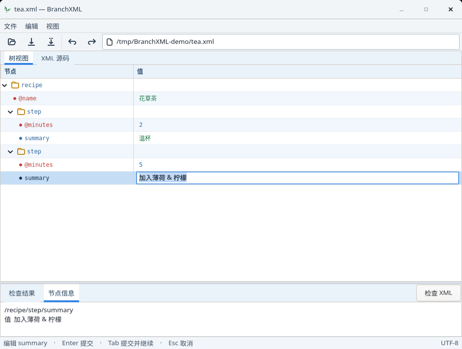
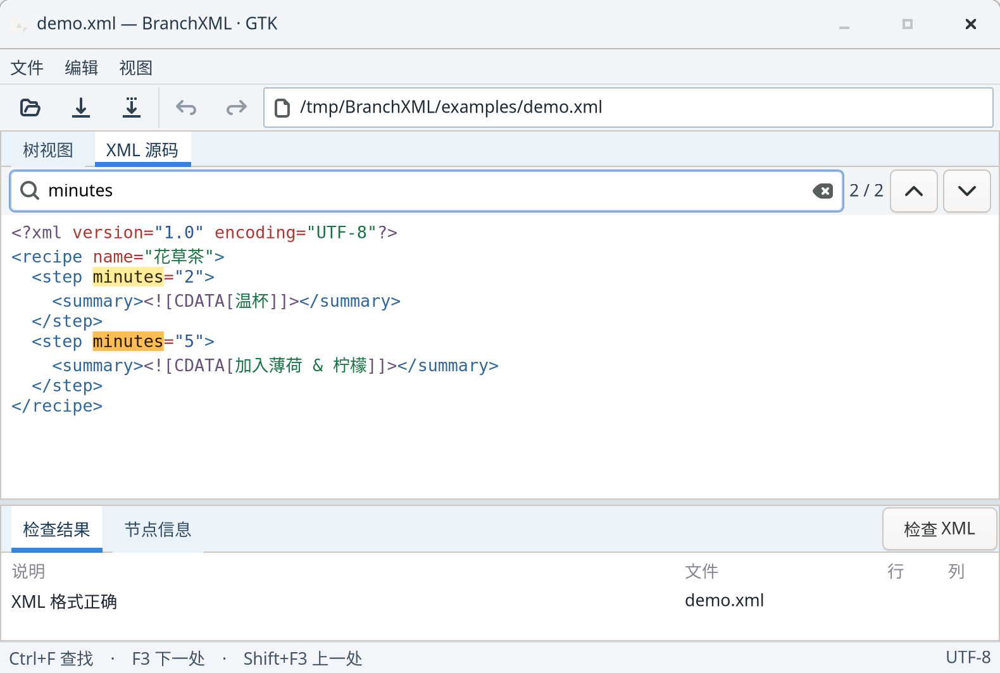

# BranchXML — Linux 桌面的树形 XML 编辑器

[下载架构无关的 .deb 安装包（v0.1.0）](https://github.com/hqy2435662352/branchxml/releases/download/v0.1.0/branchxml_0.1.0_all.deb) · [最新版本和校验文件](https://github.com/hqy2435662352/branchxml/releases/latest) · [English](README.md)

打开一份 XML 配置或配方文件，在左侧树里找到节点，点右侧的值就能修改。按 **Tab** 可以接着改下一个字段。只改一个值时，周围的 XML 会逐字节保留，包括缩进、属性引号和换行。

如果你在 Windows 上用过 Microsoft XML Notepad，会认得这种两栏布局。你也可以搜索已收起的分支，用 XPath 定位属性，或用本地 XML Schema（XSD）校验文件。



## 在 Ubuntu 上安装

amd64 和 arm64 下载同一个 `.deb`。包中包含 Python 程序和应用资源，架构字段为 `Architecture: all`。发行版需要为本机架构提供相应依赖，其中包括 GTK 4.12 或更高版本。

BranchXML 0.1.0 已在 **Ubuntu 24.04 LTS 和 26.04 LTS** 上实测，两个版本均覆盖 **amd64 和 arm64**。两个 ARM64 环境都安装了发布页的 `.deb`，通过 Wayland 会话中的桌面启动器打开了 XML。改值并保存后，只有选中的属性值发生变化。撤销后再保存，文件与原件逐字节一致。[Ubuntu 24.04.5 和 26.04.1 的 ARM64 实测记录](https://github.com/hqy2435662352/branchxml/actions/runs/45737846031)

在保存 `.deb` 安装包的目录执行

```sh
sudo apt install ./branchxml_0.1.0_all.deb
```

在应用菜单中搜索 **BranchXML** 即可启动。也可以右键 XML 文件选择 **打开方式 → BranchXML**，把文件拖入窗口，或在终端运行 `branchxml "我的配方.xml"`。

界面默认跟随桌面语言，找不到匹配时使用英语。在 **视图 → 语言**（**View → Language**）里可选择 **跟随系统**、**English** 或 **简体中文**，立即生效，下次启动也会记住。系统文件选择器跟随桌面语言。

<details>
<summary>仅为当前用户安装，或从源码运行</summary>

在解压后的源码目录或仓库根目录运行 `./install.py`，默认安装到 `~/.local`。卸载用 `./install.py --uninstall`。BranchXML 使用 Python、GTK 4.12 或更高版本、PyGObject、Pygments 和 lxml。Ubuntu 对应的软件包是 `gir1.2-gtk-4.0`、`python3-gi`、`python3-pygments` 和 `python3-lxml`。依赖装在虚拟环境时，可用 `--python /路径/venv/bin/python` 指定解释器。

要直接从源码打开示例，可运行

```sh
/usr/bin/python3 prototypes/gtk/branchxml.py examples/demo.xml
```

</details>

## 试一次只改一个值

随附的花草茶配方有两个步骤。安装 `.deb` 后，运行 `branchxml /usr/share/branchxml/examples/demo.xml` 打开示例，按 **Ctrl+Shift+S** 在主目录里另存一份副本。[查看示例 XML](examples/demo.xml)

1. 在第二个 `step` 下，点击 `@minutes` 右侧的 `5`，输入 `8`。
2. 按 **Tab**，时长会提交，光标进入下一项 `summary`。随意输入几个字，再按 **Esc**，说明就会恢复为「加入薄荷 & 柠檬」。
3. 打开 **视图 → 查看未保存的改动**，可以看到只有泡茶时长发生了变化。

```diff
-  <step minutes="5">
+  <step minutes="8">
```

关掉对比窗口，按 **Ctrl+Z** 撤销时长修改，再保存，副本就与原文件逐字节一致。

## 树形阅读与编辑

右键点击节点，可以连同子节点一起复制、移动或删除。把元素拖到另一个父节点上，也能移动整棵子树。树视图用图标和颜色区分节点类型。收起分支时，点击的那一行保持在原来的屏幕位置，文档末尾允许留白。再次展开父节点时，各层子节点会恢复各自的展开状态。

<details>
<summary>键盘快捷键和节点操作</summary>

| 操作 | 用法 |
| --- | --- |
| 修改单行值 | 点击右栏的值，或选中该行按 F2。Enter 提交，Esc 取消。 |
| 连续改值 | Tab 提交并进入下一个可见的可编辑值，Shift+Tab 反向。中文输入法先处理候选词按键。 |
| 打开节点菜单 | 右键点击节点名称或同行的值。键盘操作可用 Shift+F10 或菜单键。 |
| 新增节点 | Insert 新增同级元素或属性。Ctrl+Insert 添加子元素，Alt+Insert 添加属性。输入名称后按 Enter 确认。 |
| 复制或删除 | Ctrl+D 在原节点后复制整棵子树。Delete 删除选中节点及其子节点。 |
| 移动子树 | Alt+↑ / Alt+↓ 交换同级节点。将元素名拖到另一元素的中间可移为子节点，拖到行的上边缘或下边缘则插入其前后。整次移动算一步撤销。 |
| 在树里定位 | → 展开分支或选中首个子节点，← 收起分支或返回父节点。Ctrl+J 在源码里定位选中行，也可以从源码光标跳回树中。 |
| 重命名与多行编辑 | Shift+F2 重命名元素或属性。Shift+Enter 打开多行值编辑器，Ctrl+Enter 应用。 |
| 剪切、复制和粘贴节点 | 在树中使用 Ctrl+X、Ctrl+C、Ctrl+V。选中元素时粘贴为子节点，Ctrl+Shift+V 粘贴到所选节点之后。进入值输入框后，这些键操作选中的文字。 |
| 新增各类内容 | 右键元素，选择「新增文本、注释或处理指令…」，可添加文本、CDATA、注释或处理指令。 |

复制元素会沿用其全部属性值，包括配方中的序号。复制单个属性时会生成可用的新名称。移动元素会保留原序号。普通文本节点移到一起后，XML 会把相邻的文本读成一个节点。

</details>

## 源码与检查

在树中按 **Ctrl+F** 或 **Ctrl+I** 查找节点名称和值。收起的分支也能搜到，命中时会展开对应路径。F3 和 Shift+F3 在命中行间切换，Esc 回到选中行，接着按 F2 就能改值。**Ctrl+H** 可替换当前值中的匹配文字，也可一次替换全部匹配值。全部替换算一步撤销。可选区分大小写和正则表达式，正则替换支持 `\1` 等捕获组。

从 **编辑 → 使用 XPath 查找…** 输入 XPath 1.0 表达式，例如 `//step[@minutes='5']/@minutes`，按 Enter 定位到对应节点。`count(//step)` 等表达式直接显示计算结果。可使用文档中的前缀。默认命名空间使用 `default`，也可以手动填写 `r=urn:recipes` 一类的绑定。

「XML 源码」页显示当前文档的只读源码，包括已提交、尚未保存的修改。元素名、属性名、字符串、数字和布尔值分别着色。

在源码页按 Ctrl+F 会查找显示的 XML。查找按字面匹配，忽略英文字母大小写。所有匹配项都会高亮，搜索框旁显示当前是第几项及总数。Enter 或 F3 跳到下一处，Shift+F3 回到上一处，到达首尾会循环。在搜索框按 Esc 可清空查找并返回源码。



下方的「检查 XML」检查语法和命名空间，解析器提供位置时会显示错误行列。「节点信息」显示选中节点的路径和值或子项数量。可以拖动分隔线调整节点栏宽度和检查面板高度。

通过 **视图 → 使用 XML Schema 校验…** 可为当前文档选择本地 XSD 1.0。每次提交编辑后会刷新检查结果，点击行号跳到源码。模式文件可以引用其目录及子目录中的本地文件。打开另一份文档时会清除模式。模式错误供诊断使用，保存时要求 XML 格式正确。

## 保存与撤销

直接启动应用或按 **Ctrl+N** 可新建未命名文档，第一次保存时选择路径。**Ctrl+O** 打开已有的 XML 文件，**Ctrl+L** 聚焦地址栏。输入相对路径时，以当前文档的目录为起点。

Ctrl+S 保存，Ctrl+Shift+S 另存为，保存时会一并提交正在编辑的值。写入前会校验 XML。若原文件已被其他程序修改，编辑器会提示另存为。另存为后继续编辑新文件。打开其他文件或关闭窗口时，可以保存、放弃修改或取消操作。

只改一个值时，其他位置的缩进、属性引号、实体写法、CDATA、BOM 和换行都会保留。新增、复制、移动和删除节点也只改动相应的 XML 片段。给自闭合元素添加文本时，该元素会展开为一对标签。已验证 UTF-8 和 UTF-16 文件的读写。打开含 DTD 的文档时会提示错误。

打开 **视图 → 查看未保存的改动**，可以在保存前逐行查看变化。**与另一个 XML 文件比较…** 可对照本地另一份文件，区分逐字节相同、编码不同和行尾不同的情况。

Ctrl+Z 撤销，Ctrl+Shift+Z 或 Ctrl+Y 重做。连续用 Tab 改几个值时，每个实际改动的字段算一步。新增、复制、移动和删除节点也都可以逐步撤销。正在输入时，先撤销输入框里的文字。保存后仍可撤销，打开另一个文件时重新开始记录。

## 运行测试

在 Ubuntu 图形会话中，从仓库根目录运行整套测试，覆盖键盘编辑、树视图折叠、源码查找以及保存前后的字节一致性。

```sh
/usr/bin/python3 -m unittest discover -s prototypes/gtk
```

只检查文档读写和撤销逻辑时，可以运行 `/usr/bin/python3 prototypes/gtk/test_document.py`。中文输入另在 amd64 的 Wayland 会话中用 Fcitx 4 和搜狗拼音验证过连续选词、Tab 切换和 Esc 取消。

安装 Sway 和 D-Bus 后，运行 `packaging/test-wayland.sh` 可在独立的 Wayland 会话里测试。运行 `/usr/bin/python3 packaging/build_release.py` 可在 `dist/` 生成 Debian 安装包、可按用户安装的源码包及 SHA-256 校验文件。

BranchXML 采用 [MIT 许可证](LICENSE)，各版本的改动见[发布说明](CHANGELOG.md)。
