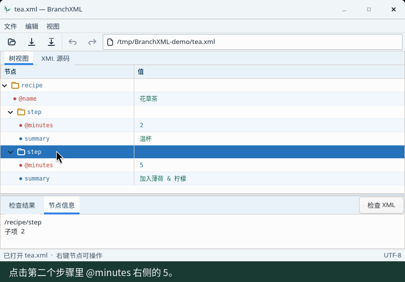

#  BranchXML

BranchXML 是一款适用于 Linux 的树形 XML 编辑器。左边展开节点，右边直接改值。只改一个属性，保存时就只动那一处，文件其余部分的缩进、引号和换行都原样保留。

**[下载 v0.1.0 安装包（.deb）](https://github.com/hqy2435662352/branchxml/releases/download/v0.1.0/branchxml_0.1.0_all.deb)** · [使用指南](docs/guide.zh-CN.md) · [English](README.md)

<picture>
  <source media="(prefers-reduced-motion: reduce)" srcset="docs/screenshots/tree-editing.png">
  
</picture>

[用示例配方跟着改一次](docs/guide.zh-CN.md#试一次只改一个值)

## 用它读写 XML

- 按 **Tab** 提交当前值，接着改下一项。**Esc** 取消正在输入的内容，**Ctrl+Z** 把已经提交的修改逐项撤回来。
- 按名称或值查找节点，收起的分支也能搜到。知道路径时，可以直接用 XPath 定位，例如 `//step[@minutes='5']`。
- 右键可以复制整棵子树。把节点拖到另一个父节点上，它的属性和子节点会一起移动。
- 按 **Ctrl+J** 可以在树和只读的 XML 源码之间跳转，直接看到节点对应的那段代码。加载本地 XSD 1.0 文件后，每次改值都会重新校验。

## 在 Ubuntu 上安装

下载上方的 `.deb`，在下载目录运行

```sh
sudo apt install ./branchxml_0.1.0_all.deb
```

在应用菜单中打开 **BranchXML**，也可以用 `branchxml settings.xml` 直接打开文件。

同一个安装包已在 Ubuntu **24.04 LTS** 和 **26.04 LTS** 的 **amd64**、**arm64** 上实测。[查看 ARM64 的安装、启动和 XML 读写测试](https://github.com/hqy2435662352/branchxml/actions/runs/45737846031)

[从源码运行及 Ubuntu 依赖](docs/guide.zh-CN.md#从源码运行) · [发布版本和校验文件](https://github.com/hqy2435662352/branchxml/releases/latest) · [MIT 许可证](LICENSE)
